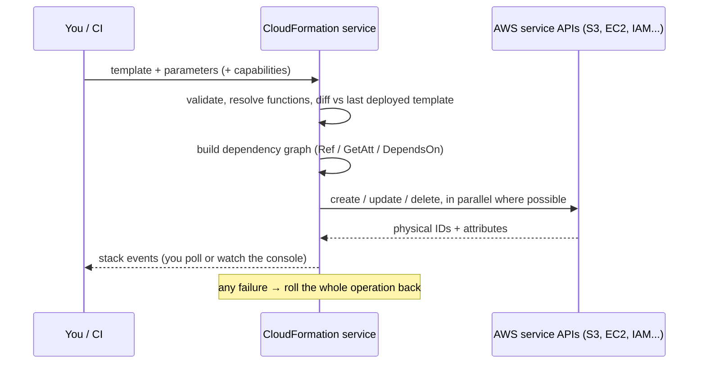

# 01 — How CloudFormation works

[← Contents](README.md)

## The problem
You've lived with Terraform state:
- Where does `tfstate` live? Who can read it? (It holds secrets in plaintext.)
- Two CI runs apply at the same time, so you add a DynamoDB lock.
- A resource gets renamed and you end up running `terraform state mv` by hand.
- A runner dies mid-apply and you're left with a half-applied stack and a stale lock.

All of these happen because **the engine and the state live on your side**.

## How CloudFormation solves it
It moves both the engine and the state into AWS. Your CLI just sends a request:



The deployed result is a **stack**: the set of resources plus the record of what was deployed. The stack *is* the state.

### Logical ID vs physical ID: the core of the state model
```yaml
Resources:
  LogsBucket:            # logical ID: your name for it, inside this template
    Type: AWS::S3::Bucket
```
After deploy, the real bucket is something like `cfn-lab-s3-logsbucket-1x2y3z`. That's the **physical ID**. CloudFormation stores the mapping `LogsBucket → cfn-lab-s3-logsbucket-1x2y3z`.

Terraform does exactly the same with `aws_s3_bucket.logs → bucket-id` in `tfstate`. **Renaming the logical ID** in either tool means "delete the old resource, create a new one", because as far as the tool knows, it's a different thing.

## Why it matters
| What changes | Why you care |
|---|---|
| No state file | Nothing to leak, back up, lock or corrupt. But also no `state mv`/`state rm`. You can't edit state by hand. |
| Built-in locking | While a stack is `*_IN_PROGRESS`, other updates are rejected. That's your DynamoDB lock, for free. |
| All-or-nothing | If a resource fails, CFN rolls the operation back. You never end up "half applied" (see [06](06-stack-lifecycle-and-rollback.md)). |
| Runs server-side | Your laptop can close mid-deploy and the deploy carries on. The deploy also survives a CI runner being killed. |
| Service role | CFN can act as an IAM role you pass (`--role-arn`). CI then only needs CloudFormation permissions plus `iam:PassRole`, not admin. |
| Events as an audit log | Every create, update or delete is a timestamped stack event with a reason. |

## Terraform lens: the tradeoffs you're accepting
- **AWS only.** No GitHub, Datadog or Cloudflare providers. You'd need custom resources for those (see [11](11-ecosystem.md)).
- **Coverage lag.** A new AWS feature sometimes reaches the Terraform provider before CloudFormation, and sometimes the other way round.
- **Less expressive language.** That's deliberate, because AWS evaluates templates on its own servers (see [02](02-templates.md)).
- **Slower feedback.** You submit, then watch events. There's no local `plan` against real state.

## Real world
- **Bootstrapping Terraform itself:** a CFN stack creates the S3 state bucket, the lock table and the GitHub OIDC role.
- **Debugging CDK/SAM:** `cdk deploy` failures show up as CloudFormation events, and you read them in the CFN console.
- **Regulated shops** often prefer CFN because no state file containing secrets ever sits in a bucket someone has to secure.

## See it yourself (M1)
1. Deploy any small stack.
2. Run `aws cloudformation describe-stack-resources --stack-name <name>`. Find `LogicalResourceId` vs `PhysicalResourceId`.
3. Run `aws cloudformation describe-stack-events --stack-name <name>`. Read the events bottom-up; that's the order things happened.

## Takeaway
> CloudFormation = Terraform where **AWS runs the engine and keeps the state**. You give up flexibility and get all-or-nothing deploys and no state to manage.
