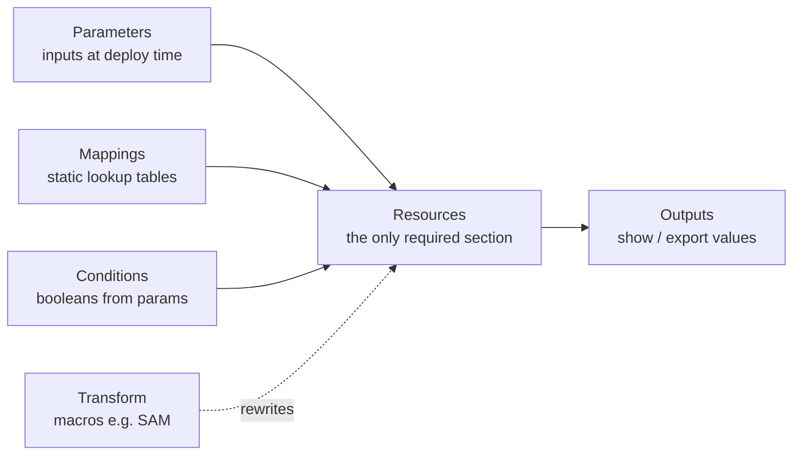

# 02 — Templates

[← Contents](README.md)

## The problem
You want to describe infrastructure as a document that **AWS** can evaluate on **its** servers, repeatably, for any account or region.

That requirement explains most of how templates look:
- AWS won't run your arbitrary code during a deploy, so there are **no loops and no general expressions**, just a small set of functions.
- The same template must work in any account or region, so you get **parameters and pseudo parameters** instead of hardcoded values.
- AWS must be able to diff it against the last deploy, so it's **pure data** (YAML/JSON), not a program.

## What a template is
One YAML or JSON file. `Resources` is the only required section; every other section exists to feed into `Resources` or expose values out of it.



| Section | Why it exists | Terraform equivalent |
|---|---|---|
| `AWSTemplateFormatVersion` | Lets AWS evolve the format. The only valid value is `"2010-09-09"`. | — |
| `Description` | Shown in the console, so people know what the stack is. | README / comment |
| `Metadata` | Extra info for tools, e.g. how to group parameters in the console form. | — |
| `Parameters` | Lets one template be deployed many times with different values. | `variable` |
| `Rules` | Validates *combinations* of parameters before anything is created. | `validation` blocks |
| `Mappings` | Static lookup tables, because there are no `locals` expressions. | `locals` map + `lookup()` |
| `Conditions` | Named booleans, because there's no `count = x ? 1 : 0`. | `count` conditionals |
| `Transform` | Lets AWS rewrite the template before processing (SAM, `AWS::LanguageExtensions`). | — (closest: codegen) |
| `Resources` | The actual infrastructure. | `resource` blocks |
| `Outputs` | Surfaces values, and optionally exports them to other stacks. | `output` |

## Anatomy of one resource
```yaml
Resources:
  LogsBucket:                       # logical ID          → aws_s3_bucket.logs
    Type: AWS::S3::Bucket           # resource type       → "aws_s3_bucket"
    DependsOn: SomethingElse        # explicit ordering   → depends_on
    Condition: IsProd               # create only if true → count = local.is_prod ? 1 : 0
    DeletionPolicy: Retain          # keep it on delete   → prevent_destroy (but stronger)
    UpdateReplacePolicy: Retain     # keep the old one if replaced
    Properties:                     # the arguments       → block body
      VersioningConfiguration:
        Status: Enabled
```
The type naming pattern is `AWS::<Service>::<Resource>`, for example `AWS::EC2::Instance` or `AWS::IAM::Role`.

## The page you'll live on: the resource reference
Every type has an AWS docs page, the equivalent of the Terraform registry page. On each one, look at three things:
1. **Properties:** what you can set, and which are *Required*.
2. **"Update requires":** whether changing a property updates in place or **replaces** the resource. See [08](08-update-behaviour-and-protection.md). This is the part that matters most in production.
3. **Return values:** what `!Ref` gives you and which `!GetAtt` attributes exist. See [03](03-intrinsic-functions.md).

## YAML or JSON?
Write YAML. It allows comments and the short tags (`!Ref`, `!Sub`) that keep templates readable. JSON is only worth it when a program generates the template. That's what CDK outputs; look in `cdk.out/*.template.json`.

## Real world
- **Vendor onboarding:** a SaaS gives you a template URL. It creates an IAM role their account can assume. Reading these is a useful security-review skill.
- **CDK output:** `cdk synth` prints the CFN template. Reading synthesized templates is how you debug CDK.
- **Limits you'll hit in large stacks:** 500 resources per template, and 51,200 bytes inline (1 MB if uploaded to S3). These limits are why stacks get split (see [09](09-composing-stacks.md)).

## See it yourself (M1)
Open the `AWS::S3::Bucket` reference page. Before writing your template, find:
- What does `!Ref` return for a bucket?
- Which property, if changed, **replaces** the bucket?

## Takeaway
> A template is **data, not a program**, because AWS evaluates it server-side. `Resources` is the only required section, and everything else feeds into it or out of it.
