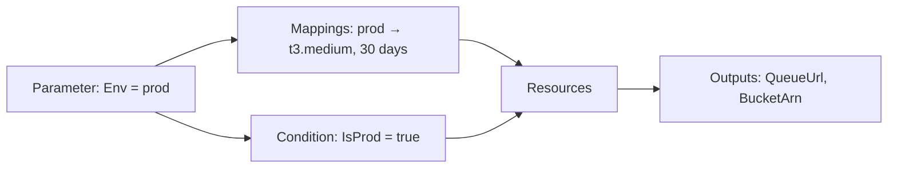

# 04 — Parameters, Mappings, Conditions, Outputs

[← Contents](README.md)

## The problem
You want **one template** for dev and prod:
- dev: small instance, single AZ, no alarms, logs kept 7 days
- prod: bigger instance, multi-AZ, alarms, logs kept 30 days

Copy-pasting two templates means they drift apart within a month. You need inputs (Parameters), a way to derive config from them (Mappings, Conditions), and a way to hand results to others (Outputs).



## Parameters → `variable`
**Why:** they're how the same template gets deployed with different values.
```yaml
Parameters:
  Env:
    Type: String
    AllowedValues: [dev, prod]       # fail fast on typos like "prd"
    Default: dev
  VpcId:
    Type: AWS::EC2::VPC::Id          # AWS-typed: CFN checks the VPC exists; console shows a dropdown
  AmiId:
    Type: AWS::SSM::Parameter::Value<AWS::EC2::Image::Id>
    Default: /aws/service/ami-amazon-linux-latest/al2023-ami-kernel-default-x86_64
```
**What's special compared with Terraform:**
- **AWS-specific types** (`AWS::EC2::VPC::Id`, `AWS::EC2::KeyPair::KeyName`) validate that the thing exists *before* anything is created. Terraform only discovers that at apply time.
- **SSM parameter types** resolve at deploy time. The `AmiId` above is always the latest Amazon Linux AMI, so you never hardcode an AMI ID that differs per region and goes stale. That's the real-world reason AMI Mappings tables mostly went away.

**Secrets:** `NoEcho: true` masks the value in the console, but it's still a parameter you have to supply. Prefer **dynamic references**, where CFN fetches the value itself at deploy time:
```yaml
MasterUserPassword: '{{resolve:secretsmanager:prod/db:SecretString:password}}'
```
Terraform comparison: the secret never lands in a state file, because there is no state file.

## Mappings → `locals` map + `lookup()`
**Why:** there are no `locals` expressions, so static per-key config goes in a lookup table.
```yaml
Mappings:
  EnvConfig:
    dev:  { InstanceType: t3.micro,  LogRetention: 7 }
    prod: { InstanceType: t3.medium, LogRetention: 30 }
# InstanceType: !FindInMap [EnvConfig, !Ref Env, InstanceType]
```
Mappings are always exactly two levels deep and fully static. **When to use them:** values that are known and fixed per environment or region. **When not to:** anything that changes often. Use a parameter or SSM instead, so you don't have to edit the template.

## Conditions → `count = cond ? 1 : 0`
**Why:** they turn whole resources, or single properties, on and off per environment.
```yaml
Conditions:
  IsProd: !Equals [!Ref Env, prod]

Resources:
  CpuAlarm:
    Type: AWS::CloudWatch::Alarm
    Condition: IsProd                # whole resource only in prod
    Properties: { ... }

  Db:
    Type: AWS::RDS::DBInstance
    Properties:
      MultiAZ: !If [IsProd, true, false]
      BackupRetentionPeriod: !If [IsProd, 7, !Ref AWS::NoValue]   # NoValue = property omitted
```
**Real world:** the most common pattern is "prod gets HA + alarms + backups, dev gets the cheap version", all from one reviewed template.

Note the difference from Terraform: a conditional resource in TF becomes a list (`aws_cloudwatch_metric_alarm.cpu[0]`). In CFN it keeps its normal name, but **anything referencing it must also be conditional**. Otherwise the deploy fails in dev.

## Outputs → `output`
**Why:** they show values to humans (`describe-stacks`) and, with `Export`, to other stacks.
```yaml
Outputs:
  BucketArn:
    Value: !GetAtt Bucket.Arn
    Export:
      Name: !Sub "${AWS::StackName}-BucketArn"
```
Exporting creates a **contract**: CFN won't let you delete or change an export another stack imports. Whether that's a feature or a burden is covered in [09](09-composing-stacks.md).

## See it yourself (M3)
Deploy the same template twice: once with `--parameter-overrides Env=dev`, once with `Env=prod` (as different stack names). Compare the resources with `describe-stack-resources`. The difference is your Conditions at work.

## Takeaway
> Parameters bring values in, Mappings and Conditions derive config, and Outputs push values out. Use AWS-typed and SSM parameters to validate early and avoid hardcoding. Use dynamic references for secrets.
