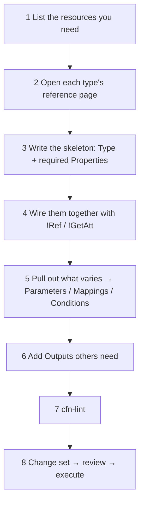

# 05 — Writing a custom template

[← Contents](README.md)

> "Custom template" just means a template you write for your own needs. Don't confuse it with a **custom resource**, which is a Lambda that CloudFormation calls to manage something it doesn't support natively (see [11](11-ecosystem.md)).

## The problem
You know what you want ("a queue with a dead-letter queue"), but how do you get from that to a working template without guessing property names?

## The workflow (same mindset as writing Terraform)


| Step | Why | Terraform habit it replaces |
|---|---|---|
| 1. List resources | Forces you to think about the graph before writing YAML | Sketching `resource` blocks |
| 2. Reference page | Property names, required fields, **update behaviour**, return values | Registry docs |
| 3. Skeleton | Get something deployable first, then improve | Same |
| 4. Wire with Ref/GetAtt | Creates the dependency order automatically | `aws_x.y.arn` references |
| 5. Parameterise | Only what really differs per deploy; everything else stays hardcoded | `variable` sprawl is a smell in both tools |
| 6. Outputs | Make the stack useful to humans and other stacks | `output` |
| 7. `cfn-lint` | Catches wrong property names and types before AWS does | `terraform validate` + tflint |
| 8. Change set | See what will happen before it happens | `terraform plan` |

## Worked example: SQS queue + dead-letter queue
(It's deliberately *not* the S3 bucket. That one is yours to write in M1.)

**Step 1 — resources:** a main queue, a DLQ, and the main queue's redrive policy pointing at the DLQ.
**Step 2 — reference page facts:** `!Ref` on `AWS::SQS::Queue` returns the **queue URL**, while `!GetAtt Q.Arn` returns the ARN. `RedrivePolicy` needs the DLQ's **ARN**.

```yaml
AWSTemplateFormatVersion: "2010-09-09"
Description: Orders queue with a dead-letter queue

Parameters:
  Env:
    Type: String
    AllowedValues: [dev, prod]
    Default: dev
  MaxReceiveCount:
    Type: Number
    Default: 5
    MinValue: 1

Resources:
  OrdersDLQ:
    Type: AWS::SQS::Queue
    Properties:
      MessageRetentionPeriod: 1209600        # 14 days: time to investigate failures
      # No QueueName on purpose: CFN generates one, so replacement is always possible (see 08)

  OrdersQueue:
    Type: AWS::SQS::Queue
    Properties:
      VisibilityTimeout: 60
      RedrivePolicy:
        deadLetterTargetArn: !GetAtt OrdersDLQ.Arn   # this reference makes CFN create the DLQ first
        maxReceiveCount: !Ref MaxReceiveCount
      Tags:
        - Key: env
          Value: !Ref Env
        - Key: stack
          Value: !Ref AWS::StackName

Outputs:
  QueueUrl:
    Value: !Ref OrdersQueue                  # Ref on SQS = URL
  QueueArn:
    Value: !GetAtt OrdersQueue.Arn
  DLQArn:
    Value: !GetAtt OrdersDLQ.Arn
```

**The same thing in Terraform**, for comparison:
```hcl
variable "env"               { default = "dev" }
variable "max_receive_count" { default = 5 }

resource "aws_sqs_queue" "orders_dlq" {
  message_retention_seconds = 1209600
}

resource "aws_sqs_queue" "orders" {
  visibility_timeout_seconds = 60
  redrive_policy = jsonencode({
    deadLetterTargetArn = aws_sqs_queue.orders_dlq.arn
    maxReceiveCount     = var.max_receive_count
  })
  tags = { env = var.env }
}

output "queue_url" { value = aws_sqs_queue.orders.url }
```
What to notice: the structure is nearly identical. The differences are syntax (`!GetAtt` vs `.arn`), that CFN accepts the redrive policy as a YAML object while Terraform needs `jsonencode`, and the fact that `!Ref` on a queue means *URL*.

**Steps 7–8 — validate and deploy safely:**
```bash
cfn-lint queue.yaml
aws cloudformation deploy --template-file queue.yaml --stack-name cfn-lab-queue \
  --parameter-overrides Env=dev --no-execute-changeset     # creates the change set only
aws cloudformation describe-change-set --stack-name cfn-lab-queue --change-set-name <name-from-output>
aws cloudformation execute-change-set  --stack-name cfn-lab-queue --change-set-name <name>
```
Cost: SQS is effectively free at this scale, so this example is safe to try.

## Other ways to get a template (real world)
| Source | When it's useful |
|---|---|
| **IaC generator** (console → CloudFormation → IaC generator) | You clicked something together in the console and want a template for it. It scans existing resources. |
| **`cdk synth`** | You want to see what valid CFN for a complex pattern looks like. |
| **AWS samples / vendor templates** | Starting points. Always read them before deploying (look for IAM roles). |
| **Editor support** | The VS Code CloudFormation extension + cfn-lint give autocomplete and inline errors. |

## Takeaway
> Writing a template is the same discipline as Terraform: list resources, read the reference page, wire references, parameterise only what varies, lint, then preview. The reference page's **Return values** and **Update requires** sections are the parts people skip and then regret.
