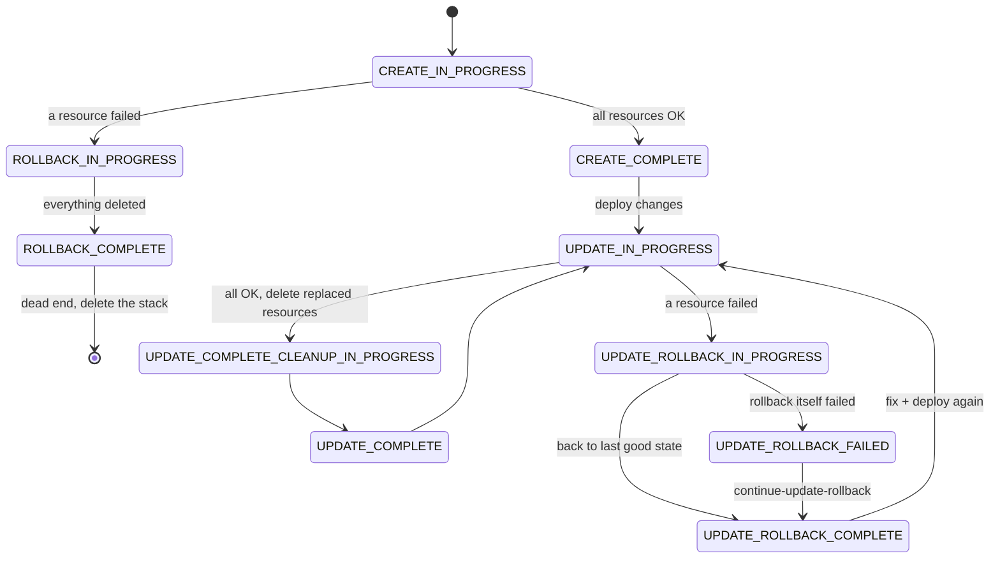

# 06 — Stack lifecycle & rollback

[← Contents](README.md)

## The problem
A deploy creates 10 resources. Number 7 fails (bad property, missing permission, name taken). What state is your infrastructure in now?

- **Terraform:** resources 1–6 exist, and state records them. You fix the error and `apply` again: *fix forward*. Fine on dev, scary on prod at 2 a.m.
- **CloudFormation:** it **rolls back**. Resources 1–6 are deleted (on create) or reverted (on update), and the stack returns to its last known good state.

That all-or-nothing guarantee is the main operational difference between the two tools.

## The lifecycle


## What each status means for *you*
| Status | What happened | What you do |
|---|---|---|
| `*_IN_PROGRESS` | Working. The stack is **locked**; other updates are rejected. | Wait, and watch events. |
| `CREATE_COMPLETE` / `UPDATE_COMPLETE` | Success | Nothing |
| `ROLLBACK_COMPLETE` | The **first create** failed and everything was removed | **Delete the stack**, fix, create again. It can't be updated. |
| `UPDATE_ROLLBACK_COMPLETE` | An update failed and the stack is back to the previous version | Read the events, fix, deploy again. The stack is healthy. |
| `UPDATE_ROLLBACK_FAILED` | The rollback itself couldn't complete (often because someone deleted or changed a resource by hand) | Fix the cause, then `continue-update-rollback`, optionally `--resources-to-skip`. |
| `DELETE_FAILED` | Something blocked deletion (non-empty bucket, resource in use) | Fix the blocker and delete again, or retain that resource. |

### Why `ROLLBACK_COMPLETE` is a dead end
There's no "last good state" to update *from*, because the stack never succeeded. Real-world impact: a CI pipeline whose first deploy fails will keep failing until someone deletes the stack. Good pipelines check for `ROLLBACK_COMPLETE` and delete before retrying.

### Why updates have a CLEANUP phase
When a property change needs **replacement**, CFN creates the *new* resource first, switches references to it, and deletes the *old* one only once the whole update has succeeded (`*_CLEANUP_IN_PROGRESS`). That keeps downtime low and allows a rollback. It also explains a classic error, covered in [08](08-update-behaviour-and-protection.md): a resource with a *fixed custom name* can't be replaced, because the new one can't share the old one's name.

## Controls you have
| Control | Why it exists | Real-world use |
|---|---|---|
| `--disable-rollback` / `--on-failure DO_NOTHING` | Keep the failed resources so you can inspect them | Debugging in dev (e.g. look at a failed EC2 instance's console). Never in prod. |
| Rollback triggers (`--rollback-configuration`) | Roll back if a **CloudWatch alarm** fires during or shortly after the deploy | A deploy "succeeds" but error rates spike, and CFN reverts automatically. A cheap safety net close to a canary. |
| `continue-update-rollback --resources-to-skip` | Get out of `UPDATE_ROLLBACK_FAILED` | Someone deleted a resource manually, so tell CFN to skip it. |
| Termination protection | Block `delete-stack` | Prod stacks |

## Reading events: the most important skill
```bash
aws cloudformation describe-stack-events --stack-name cfn-lab-s3 \
  --query "StackEvents[?contains(ResourceStatus,'FAILED')].[LogicalResourceId,ResourceStatusReason]" \
  --output table
```
The **first** `*_FAILED` event in time (the bottom of the list) is the real cause. Everything after it is fallout, mostly "Resource creation cancelled".

## See it yourself (M1–M2)
1. Create a stack with an invalid property, so you land in `ROLLBACK_COMPLETE`. Try to update it and read the error. Delete it.
2. Make a *valid* stack, then push a broken update, so you land in `UPDATE_ROLLBACK_COMPLETE`. Confirm the original resources are untouched.

## Takeaway
> CloudFormation operations are all-or-nothing. A failed first create means delete and retry; a failed update returns to the last good state. The first FAILED event is the real cause.
