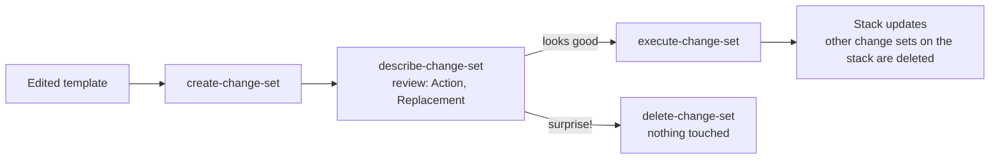

# 07 — Change sets: CloudFormation's `terraform plan`

[← Contents](README.md)

## The problem
You edit one line in a prod template, say a database's `DBInstanceIdentifier` or an EC2 instance's `AvailabilityZone`. It looks harmless. In reality it **replaces** the resource: a new empty database, and the old one deleted.

You need to see *before* executing:
- what will be added, modified or removed,
- whether anything will be **replaced**,
- and you want someone else to review the same preview.

## The idea
A **change set** is a preview that CloudFormation computes and **stores on the stack**. You create it, inspect it, and then either execute it or delete it.



## Terraform lens
| | `terraform plan -out=tfplan` | Change set |
|---|---|---|
| Computed by | Your CLI, against refreshed state | The CloudFormation service, against the last **deployed template** |
| Stored | A local file | On the stack, by name, viewable in the console |
| Reviewable by others | Only if you share the file or output | Anyone with access to the stack |
| Applying it | `terraform apply tfplan` | `execute-change-set` |
| Becomes invalid when | State changes | Another change set is executed first |
| Sees drift? | Yes (refresh) | **No**: it diffs template vs template, not reality (see [10](10-drift-detection.md)) |

Two differences that matter:
1. **The change set compares templates, not live resources.** If someone changed a resource by hand, the change set won't tell you.
2. **`aws cloudformation deploy` uses change sets under the hood.** It creates one and executes it immediately. Add `--no-execute-changeset` to stop after creating it.

## Reading a change set
```bash
aws cloudformation describe-change-set --stack-name cfn-lab-s3 --change-set-name cs1 \
  --query "Changes[].ResourceChange.[Action,LogicalResourceId,ResourceType,Replacement]" --output table
```
Illustrative output:
```
| Modify | LogsBucket | AWS::S3::Bucket       | True  |   ← STOP and think
| Add    | Alarm      | AWS::CloudWatch::Alarm| None  |
| Modify | AppRole    | AWS::IAM::Role        | False |
```

| Field | Values | How to read it |
|---|---|---|
| `Action` | `Add`, `Modify`, `Remove`, `Import`, `Dynamic` | Like TF's `+`, `~`, `-` |
| `Replacement` | `True`, `False`, `Conditional` | **`True` = new physical resource, old one deleted.** `Conditional` = depends on a value CFN can't know yet. Treat it as `True`. |
| `Scope` | `Properties`, `Tags`, `Metadata`, `DeletionPolicy`, ... | What part of the resource changes |
| `Details[].Target.RequiresRecreation` | `Never`, `Conditionally`, `Always` | The per-property reason behind `Replacement` |
| `Details[].Evaluation` | `Static`, `Dynamic` | `Dynamic` = decided at execution time (e.g. it depends on another resource's new attribute) |
| `Details[].ChangeSource` | `DirectModification`, `ParameterReference`, `ResourceReference`, ... | *Why* it changed: you edited it, a parameter changed, or something it references changed |

`ChangeSource: ResourceReference` is the subtle one. You didn't touch resource B, but it references A, and A is being replaced. So B changes too: a cascading change you didn't intend.

## What a change set does *not* tell you
- **Whether the change will succeed.** IAM permissions, name collisions and service limits only surface at execution time.
- **Drift.** It's blind to manual changes.
- **Inside nested stacks**, unless you create it with `--include-nested-stacks`.

## Real world
- **PR workflow (M8):** on a PR, CI creates a change set and posts the `Action/Replacement` table as a comment. On merge, it executes that change set. That's the same review loop as `terraform plan` in a PR, with no state backend involved.
- **Manual approval gate:** the pipeline creates the change set, a human approves in CodePipeline or GitHub Environments, and only then does it execute.
- **The rule teams use:** any `Replacement: True` on a stateful resource (RDS, DynamoDB, EFS, S3 with data) blocks the merge until someone explicitly signs off.

## See it yourself (M2)
1. On your bucket stack, change a **tag**, create a change set and check `Replacement`.
2. Change the **BucketName** and create another change set. Compare.
3. Delete the second one without executing. Confirm nothing changed.

Predict both `Replacement` values before you look.

## Takeaway
> A change set is a stored, reviewable plan. **Check `Replacement` before anything else.** It compares templates, not reality, so it won't show drift, and it doesn't guarantee success.
