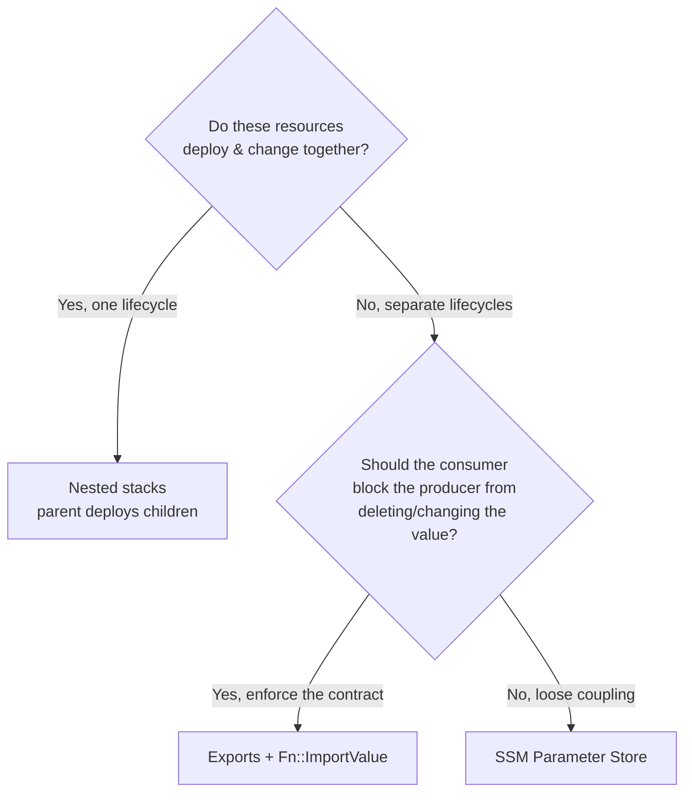

# 09 — Composing stacks: exports, nested stacks, SSM

[← Contents](README.md)

## The problem
Your first instinct is one stack for everything: VPC, databases, apps, IAM. Within weeks:
- **Blast radius:** a typo in an app's security group sends the stack holding your VPC into rollback.
- **Different rhythms:** the network changes twice a year, the app ten times a day. Every app deploy re-evaluates the VPC.
- **Different owners:** the platform team owns networking, product teams own apps, and they shouldn't be able to break each other.
- **Hard limits:** 500 resources per stack.

This is the same reason you split Terraform into multiple root modules / state files. The question is how split stacks share values (VPC ID, subnet IDs, role ARNs).

## The three options


### 1. Outputs + `Export` → `Fn::ImportValue` ≈ `terraform_remote_state`
```yaml
# network stack
Outputs:
  VpcId:
    Value: !Ref Vpc
    Export: { Name: !Sub "${AWS::StackName}-VpcId" }

# app stack
  SecurityGroup:
    Type: AWS::EC2::SecurityGroup
    Properties:
      VpcId: !ImportValue cfn-lab-network-VpcId
```
**What makes it different:** CFN **tracks who imports what**. While any stack imports `cfn-lab-network-VpcId`:
- you **can't delete** the network stack,
- you **can't change or remove** that export.

| Good | Bad |
|---|---|
| The platform team can't accidentally pull the VPC out from under running apps | Changing a shared value means updating every consumer first: the "deadly embrace" |
| Dependencies are visible: `aws cloudformation list-imports --export-name X` | Same region and account only |

Terraform's `terraform_remote_state` is the *loose* version: the producer can change anything and consumers find out on their next plan.

### 2. Nested stacks ≈ Terraform modules
```yaml
# parent.yaml
Resources:
  Network:
    Type: AWS::CloudFormation::Stack
    Properties:
      TemplateURL: ./network.yaml          # `aws cloudformation package` uploads it to S3 and rewrites the URL
  App:
    Type: AWS::CloudFormation::Stack
    Properties:
      TemplateURL: ./app.yaml
      Parameters:
        VpcId: !GetAtt Network.Outputs.VpcId   # child outputs passed as params, no exports
```
- **One lifecycle:** you deploy the parent and all children update together, rolling back together.
- Each child is a real stack (you'll see it in the console), but you **manage it only through the parent**.
- Real-world use: reusable building blocks (a "standard VPC" template used by many parents), and getting past the 500-resource limit.

### 3. SSM Parameter Store: loose coupling
The producer writes `/platform/vpc-id` (an `AWS::SSM::Parameter` resource). The consumer reads it with a parameter type:
```yaml
Parameters:
  VpcId:
    Type: AWS::SSM::Parameter::Value<String>
    Default: /platform/vpc-id
```
- No lock: the producer can change the value freely. Consumers pick up the new value **only when they next deploy**.
- Any tool can read it: Terraform, scripts, Lambda. A good bridge if parts of your estate are TF and parts are CFN.

## Side by side
| | Exports / ImportValue | Nested stacks | SSM parameters |
|---|---|---|---|
| Terraform analogue | `terraform_remote_state` (but strict) | Modules | `data "aws_ssm_parameter"` |
| Coupling | Hard, enforced by CFN | One unit | Loose |
| Lifecycles | Independent | Shared | Independent |
| Producer can change value? | No, not while imported | Yes (it's all one deploy) | Yes, silently |
| Typical owner split | Platform team → app teams | One team | Mixed tools / teams |

## See it yourself (M4, M7)
- M4: build network + app with exports. Try deleting the network stack, then try changing the exported value. Both are blocked. Read the error messages.
- M7: wrap both in a parent with nested stacks. Notice that you no longer need exports at all.

## Takeaway
> Split stacks by **lifecycle and ownership**. Use nested stacks for "deploys together", exports when the consumer must be protected, and SSM when the two sides need to change independently.
