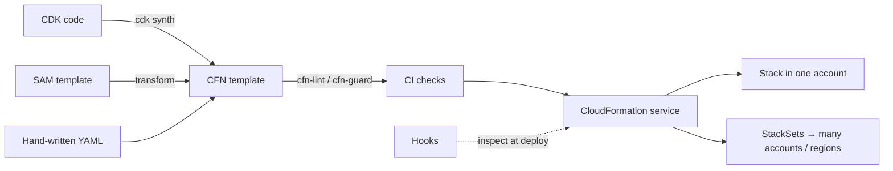

# 11 — The ecosystem around CloudFormation

[← Contents](README.md)

The core is templates and stacks. These tools exist because the core leaves gaps: authoring is verbose, there's no multi-account fan-out, no policy-as-code, and no non-AWS resources. Knowing which gap each one fills tells you when to reach for it.

| Tool | Gap it fills | Terraform analogue | When you'd use it |
|---|---|---|---|
| **cfn-lint** | Typos and invalid properties only surface at deploy time | `terraform validate` + tflint | Always, locally and in CI |
| **cfn-guard** | Enforcing rules ("all buckets encrypted") before deploy | OPA / Sentinel / Checkov | CI policy gate |
| **CloudFormation Hooks** | Enforcing rules *inside* CFN at deploy time, account-wide | Sentinel in TF Cloud | Platform teams enforcing guardrails nobody can skip |
| **Change set + `--include-nested-stacks`** | Previewing changes inside nested stacks | `plan` across modules | Parent/child deployments |
| **StackSets** | Deploying one template to many accounts and regions | Pipelines looping over workspaces / Terragrunt | Org-wide baselines: CloudTrail, Config rules, IAM roles in every account |
| **Custom resources** (Lambda-backed) | Things CFN can't do natively: call an API, seed data, look something up | `null_resource` / `external` / a custom provider | Rare. Prefer native resources; custom ones add a Lambda to maintain |
| **Registry / third-party types** | Non-AWS resources as first-class CFN types | Third-party providers | Vendors that publish types (smaller ecosystem than TF providers) |
| **Macros / Transforms** | Template generation (loops, shortcuts) | — | `AWS::Serverless` (SAM), `AWS::LanguageExtensions` (`Fn::ForEach`) |
| **SAM** | Verbose serverless templates | `terraform-aws-modules/lambda` | Lambda + API Gateway apps (`sam build`, `sam local`) |
| **CDK** | YAML has no real programming: loops, abstractions, types | CDKTF / Pulumi | Large apps where code reuse matters; compiles to CFN |
| **IaC generator** | Turning existing click-ops resources into a template | `terraform import` + generated config | Adopting legacy infrastructure |
| **Rain** | The AWS CLI's deploy UX is clunky | — | Nicer deploy output, template formatting |

## Custom resources: the one gotcha worth knowing now
CFN sends your Lambda a Create/Update/Delete event and **waits for the Lambda to call back** with SUCCESS or FAILED. If your code crashes before replying, CFN waits for the timeout (an hour by default) and the stack hangs in `*_IN_PROGRESS`. Always wrap the handler in try/except and reply on every code path, including Delete.

## How they relate

Everything ends up as a CFN template processed by the same engine. That's why the core concepts in notes 01–10 transfer to all of these tools.

## Takeaway
> Every tool here fills a specific gap in core CloudFormation. CDK and SAM generate templates, lint/guard/Hooks check them, and StackSets fan them out.
